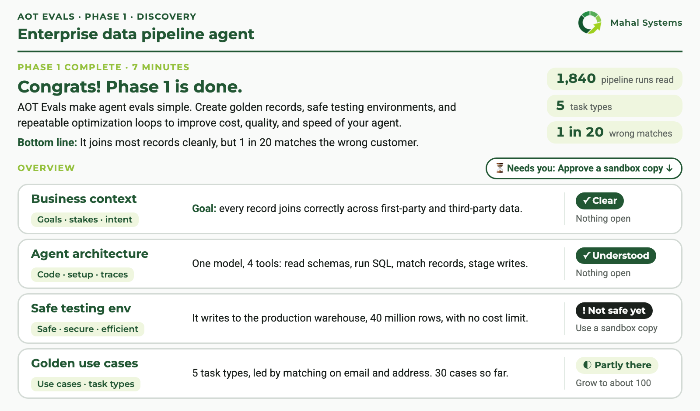

# AOT Evals

Create golden records, safe testing environments, and repeatable optimization loops to improve
cost, quality, and speed of your agent.

<p align="center">
  
</p>

A Claude Code plugin from Mahal Systems, part of **AOT, the Agent Optimization Toolkit**. It works
on **your own agent**, in your own repository. There's no service and no account, and nothing is
installed into your project.

## How to run

You need [Claude Code](https://code.claude.com), `git`, and [uv](https://docs.astral.sh/uv/)
(or Python 3.11+ with PyYAML). Install the plugin:

```bash
claude plugin marketplace add Mahalanobis-Systems/aot-evals
claude plugin install aot-evals@aot-evals
```

Or, inside Claude Code: `/plugin marketplace add Mahalanobis-Systems/aot-evals`, then
`/plugin install aot-evals@aot-evals`. Restart Claude Code afterwards.

Then open Claude Code in your agent's repository and run the one command to remember:

```
/aot-evals:start
```

The first time, it finds your agents, asks which one to test, and asks three questions about it:
what decision the tests will drive, which mistakes are much worse than others, and what a change
should have to show before it ships. About five minutes later you have a discovery report like the
one above. After that, run `/aot-evals:start` whenever you want to know where things stand. It
says how far each number can be trusted and what changed since the last baseline, then carries on
with the next step, stopping for your review along the way.

**Try it on a toy agent first (a few minutes).** In Claude Code, in any empty folder, ask:
*"Run `aot-evals demo` and show me what it made."* It builds a toy online store's support agent
and its refund subagent with an eval each, runs both baselines, then a change to the subagent that
improves its own eval and breaks refunds end to end, and decides on it. Nothing calls a model or a
network service.

Judges default to a free System One model (Jev, through OpenCode Zen) that needs no key but
allows about 250 calls a day; set `ANTHROPIC_API_KEY` to use Claude as a judge. See
[references/judge-backends.md](references/judge-backends.md). If something doesn't work, ask
Claude to run `aot-evals doctor`.

**Updating.** Releases are listed in [CHANGELOG.md](CHANGELOG.md) and on the
[releases page](https://github.com/Mahalanobis-Systems/aot-evals/releases).

```bash
claude plugin marketplace update aot-evals
claude plugin update aot-evals@aot-evals     # then restart Claude Code
```

Or turn on auto-update for the `aot-evals` marketplace in `/plugin` → Marketplaces.

## What it does for you

You ask the questions a team actually asks about its agent:

- Is this change safe to ship?
- Can I trust this number?
- How many test cases do I need, and which ones?
- Is our AI judge good enough to grade with?

You get answers in the same terms, with the next step. For example:

> **Ship it.** The new prompt is no worse on refunds, and better on order status.
>
> **Not yet.** 60 refund cases can't show refunds go wrong less than 5% of the time. About 40 more would.
>
> **Don't grade with the policy judge yet.** It needs about 80 more labeled failures before its scores count.
>
> **Don't quote the 92% yet.** Nobody has checked the eval against your reviewers' verdicts.

The statistics behind these answers are real, and Claude does them for you. It says what they mean
for your next step, not how they were computed.

### Who does what

Three groups of people take part, usually at the same time:

| Who | What they do | Where |
|---|---|---|
| **The owner** (a product owner or team lead) | Says what the agent is for, which mistakes cost the most, and what a change has to show before it ships. | `/aot-evals:start` asks them, in about five minutes. |
| **Engineering** | Wires the agent up to run safely and repeatably, builds test cases from real traffic and a check for each way it can fail, runs the baseline, and tries changes. | `/aot-evals:build` |
| **The people who know what good looks like** (experts, support staff, end users) | Label whole runs pass or fail, settle disagreements, and write the rules that AI judges then learn. | `/aot-evals:judge` and the grader application, `aot-evals serve` |

Anyone can run `/aot-evals:start` to see where each eval stands and what's next.

### The traps it keeps you out of

Most bad eval results come from a handful of mistakes. Each is easy to make, and each makes an eval
say something that isn't true. aot-evals handles every one:

| You might say | What aot-evals does instead |
|---|---|
| "Our pass rate is 91%." | Weights each kind of request by how often it comes in and what a failure costs. |
| "The refund team's new prompt cuts policy mistakes in half." | Checks the whole agent too, because a better part can still make a worse agent. |
| "The eval still says 92%, but complaints are up." | Notices when traffic, the agent or a check has changed, and says how to catch up. |
| "We wrote 40 tough cases and it passes 70%." | Keeps the hard cases for finding bugs, and measures quality on cases drawn from real traffic. |
| "It won 24 of 30 cases." | Counts independent evidence, not near-duplicate cases. |
| "Our AI judge agrees with our reviewers 95% of the time." | Measures how often the judge misses a failure and how often it flags a good run, then corrects for both. |
| "Every check passed, so the eval is right." | Holds the whole eval to people's verdicts on whole runs. |
| "74% yesterday, 81% today. The fix worked." | Runs each case more than once and separates real change from noise. |
| "All 10 refund cases passed. Refunds work." | Says how many cases it takes to show a rare failure is rare. |
| "Version B scores 5 points higher." | Compares the two versions case by case, not average to average. |
| "No significant difference. Ship the cheaper model." | Tests "no worse" directly, against a margin you choose. |
| "We kept labeling until it cleared 85%." | Fixes the sample size before anyone looks at results. |

Each trap has a worked example, all on the same toy online store, in
[docs/problems.md](docs/problems.md).

## Under the hood

You don't need any of this to use aot-evals. It's here for anyone who wants to check the work.

Each eval is written down in one file, `eval.yaml`, as a statistical estimator with four parts:
what number it estimates and for which decision, which cases it draws, how wrong its grader is,
and when it acts. None of it is new. Each part comes from a field that solved it long ago, from
survey sampling to diagnostic testing to clinical trials. [docs/estimators.md](docs/estimators.md)
sets out the model, and [docs/statistics.md](docs/statistics.md) derives every number.
[docs/method.md](docs/method.md) is the reference for every command, file and check.

In practice:

- **One headline number, weighted** by each kind of request's share of traffic and the cost of
  a failure in it. A per-request-type table sits beside it, and both have an interval.
- **Two sets of cases.** A bug-finding set is picked by hand to find failures. A quality set is
  drawn at random from real traffic. Only the second one is a rate.
- **Case counts come from the decision.** A judge whose mistakes would cost more than twice the
  cases of a code check doesn't count.
- **Paired, clustered comparisons** of a changed agent, and direct tests of "no worse". A
  change to one component ships only when the whole agent shows no regression too.
- **A fixed `report.json` schema** (`aot-evals/report@2`). Claude renders it into a local HTML
  report written for the question you asked.
- **A local catalog of over 350 public agent benchmarks**
  ([references/benchmarks.md](references/benchmarks.md)). The first run matches your agent
  against it without a web search, and says what each match is good for: a grading design, a
  case template, a sandbox design or a baseline number. The matches also suggest situations the
  bug-finding set should cover (unanswerable, ambiguous, forbidden, multi-turn, …). Cases still
  come from your own traffic, never from a benchmark.

The first run's discovery report covers the four things good evals rest on:

| | What it means | What we look at |
|---|---|---|
| **Business context** | Why the agent exists, who relies on it, and what it costs when it answers wrong. | Goals · stakes · intent |
| **Agent architecture** | Its code, prompts, models and tools, its production setup, and the traces of real runs. When the setup and the traces disagree, we trust the traces. | Code · setup · traces |
| **Safe testing environment** | Runs that can't touch real people, data or money, and are fast and cheap to repeat. | Safe · secure · efficient |
| **Golden test cases** | Examples drawn from real runs, grouped by the kinds of request the agent actually handles. | Test cases · kinds of request |

Coming from 1.x? `aot-evals migrate --to 2` converts a suite. See [CHANGELOG.md](CHANGELOG.md).

<details>
<summary><b>What ships</b></summary>

| Part | Where |
|---|---|
| Skills: `start` (the one to remember: the first run, then where things stand and what's next), `build` (engineering: cases, checks, the baseline, changes), `judge` (the people who know what good looks like: the grader application, agreement, AI judges), `report`. All but `report` appear in the `/` menu | [skills/](skills/) |
| `aot-evals` CLI: the deterministic half (the eval spec, import, plan and draw, screening, runs, labels, calibration and reliability, operational counters, comparisons and decisions, `report.json`) | [bin/aot-evals](bin/aot-evals), [src/aot_evals/](src/aot_evals/) |
| The evals the plugin keeps in your repository, `evals/agents/<agent>/<eval>/` | [docs/method.md §4](docs/method.md#4-files); templates in [src/aot_evals/templates/evals/](src/aot_evals/templates/evals/) |
| Case, code-check and judge templates | [templates/](templates/) |
| The twelve problems, the method reference, the estimator model and its statistics | [docs/](docs/) |
| Reference material: sourced literature findings, the agent contract, judge backends, the benchmark catalog | [references/](references/) |
| The grader application (`aot-evals serve`) | [src/aot_evals/serve.py](src/aot_evals/serve.py) |
| A toy agent with two finished evals (`aot-evals demo`) | [examples/store/](examples/store/) |
| Banner mod: draws the AOT EVALS banner in the terminal when `aot-evals start` runs | [hooks/](hooks/) |
| Brand: the AOT logo, the embedded fonts (SIL OFL 1.1), and the rules every HTML report follows | [brand/](brand/) |

</details>

<details>
<summary><b>The CLI</b></summary>

The skills drive the CLI for you, but you can run it directly in a Claude Code session. With
several agents in one repository, pass `--agent NAME` to every command.

```bash
aot-evals demo [DIR]                             # the online store: two evals, both baselines, a change decided
aot-evals doctor                                 # check the environment
aot-evals build [--run]                          # create the evals from the discovery report; --run the baselines
aot-evals --eval ID init [--component NAME]      # create one eval folder with its eval.yaml
aot-evals status                                 # where each eval stands, its trust, what changed, what's next
aot-evals validate                               # every missing or invalid field of each eval spec
aot-evals import traces.jsonl --source ... --query ... --window ...   # a frame to draw from
aot-evals --eval ID handoffs                     # a component eval's frame, from the end-to-end traces
aot-evals ops --export <id> --field cost_usd=... # operational costs, before any label
aot-evals run --purpose smoke --question "..."   # the agent runs end to end
aot-evals --eval ID plan --write                 # case targets per use case, from the decision rule
aot-evals --eval ID draw                         # the seeded random draw of the quality set
aot-evals screen; aot-evals screen --read-by NAME --case ID
aot-evals --eval ID run --purpose baseline       # k from the spec (judges run with their primary backend)
aot-evals run ... --pause-every 20 --pause-seconds 900   # pace a rate-limited runtime
aot-evals --eval ID serve --open                 # the grader application: label, rule, triage, rules, judges
aot-evals agreement label queue --changed        # label only what the last change moved
aot-evals agreement                              # the eval held to people
aot-evals label queue --judge J --open; aot-evals label import --judge J --csv ...
aot-evals calibrate --judge J                    # catch and clean pass rates per backend
aot-evals reliability --judge J --backend A --backend B
aot-evals --eval ID run --purpose candidate --variable model=...   # a changed agent
aot-evals --eval ID compare                      # the paired comparison and the decision
aot-evals coverage                               # the bug-finding set against the coverage list
aot-evals --eval ID report                       # <eval>/report/report.json
aot-evals activity --open                        # the live activity log (every command logs itself)
aot-evals log "..." [--kind finding|decision|question]   # add to it
aot-evals migrate --to 2 [--dry-run]             # convert a 1.x suite
```

Sequential looks, a reusable holdout for optimizers, drift monitoring and online evaluation are
described in the method but not yet computed ([docs/method.md §13](docs/method.md#13-not-in-20)).

</details>

## Telemetry

AOT Evals sends pseudonymous usage telemetry so we can see how many teams use it and how far they
get: a random local install id, the milestone reached (the assessment started, discovery report written,
a checkpoint at a gate, a report built), the gate id, the version, your OS name and a timestamp.
It **never** sends your code, agent, repository, cases, answers, file paths or IP address. A
notice is shown before the first event, and it's off whenever Claude Code's own telemetry is off,
on Bedrock, Google Cloud and Foundry, and in CI. See exactly what would be sent:

```bash
aot-evals telemetry show
```

Turn it off with `aot-evals telemetry off`, `AOT_EVALS_TELEMETRY=0` or `DO_NOT_TRACK=1`. Details,
retention and how to have your data deleted: [SECURITY.md](SECURITY.md#telemetry).

Separately, AI graders send the case and the agent's answer to the judge backend you use, by
default the free System One model on OpenCode Zen. Your code, traces, cases and reports stay in
your repository.

## Contributing

Feedback, bug reports and pull requests are welcome: see [CONTRIBUTING.md](CONTRIBUTING.md). To
report a security problem, see [SECURITY.md](SECURITY.md).

Releases follow [Semantic Versioning](https://semver.org/). Every user-visible change is noted
under `## Unreleased` in [CHANGELOG.md](CHANGELOG.md). To release, a maintainer runs
`python3 scripts/release.py X.Y.Z`, which sets the version everywhere it lives and moves the
changelog notes under the new version, then merges that as a pull request. On merge, a GitHub
Action tags the commit `aot-evals--vX.Y.Z` and publishes a GitHub release. The marketplace
installs the plugin from that tag, so users only ever get released code. The full process is in
[CONTRIBUTING.md](CONTRIBUTING.md#releasing).

```bash
uv run --no-project --python 3.11 --with pyyaml --with pytest env PYTHONPATH=src python -m pytest -q
uvx ruff check src tests scripts
claude --plugin-dir .          # run Claude Code with your working copy of the plugin
AOT_EVALS_LIVE=1 uv run --no-project --python 3.11 --with pyyaml --with pytest env PYTHONPATH=src \
  python -m pytest -q tests/test_live_systemone.py   # opt-in: six free calls to Jev on OpenCode Zen
```

## The agent contract

Your agent runs as a command; framework, language and model provider don't matter. Each test
case arrives as one JSON object on stdin, and the agent prints one JSON object to stdout: its
answer, plus optional usage (tokens, cost, tool calls), the model ids it used, a trace id and an
outcome code. Two optional hooks let checks grade what the agent actually changed: `seed` puts
the world into the case's start state before each attempt, and `observe` prints the world's
state before and after. The full contract is in
[references/agent-contract.md](references/agent-contract.md).

## License

[Apache License 2.0](LICENSE). The bundled fonts are under the SIL Open Font License 1.1, and the
Mahal Systems and AOT names and logo are trademarks; see [NOTICE](NOTICE).
